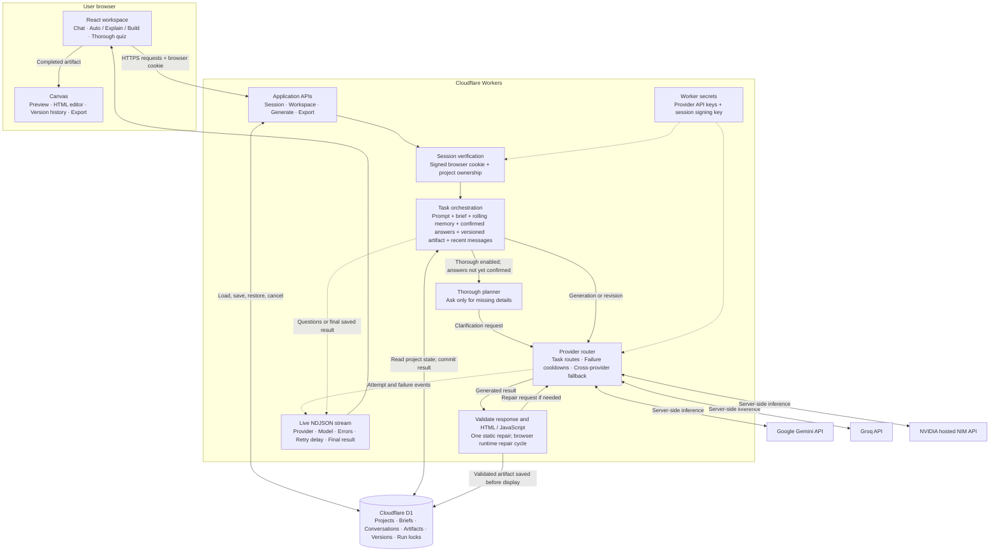
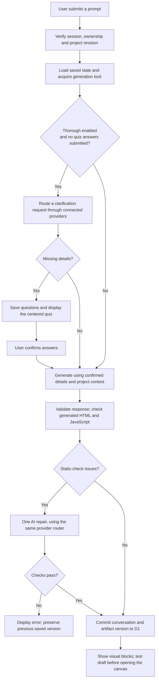

# Convoke architecture

Current implementation, October 14, 2026. Convoke runs as a React/Vinext application on Cloudflare Workers, with Cloudflare D1 storage and server-held provider keys.

## Request flow

## Provider fallback

- Only providers with server-held keys participate. The available pool is Gemini, Groq and NVIDIA; there is no single-provider selector.
- Each task chooses from explicit model routes. A temporary failure moves the request to another provider after a five-second pause. The router continues transient retries across connected providers until success, cancellation, or the 20-minute deadline, and considers recent model failures. Permanent connection failures disable the affected provider or model for that request.
- Provider-required retry delays are respected before reusing an affected model. Invalid credentials or exhausted provider quota remove that provider from the current request; unavailable models are skipped.
- Live events identify the actual provider and model, task stage, sanitized failure category and retry delay. Provider secrets and raw error payloads are not sent to the browser.
- Cancellation, project ownership, revision checks and expiring locks prevent stopped or conflicting requests from overwriting saved work. Retry count and request deadlines are bounded.

## Important implementation boundaries

- The browser canvas is a saved HTML artifact, not a shared filesystem or full code repository. AI requests include the latest artifact, project brief, confirmed task and recent conversation context.
- Static validation precedes hidden iframe execution and generated interaction tests. Browser reports are stored against the exact pending version, and up to three additional AI repairs preserve previous attempts. Python runs in a terminable worker inside the opaque iframe. These checks are client observations, not trusted security attestations. There is no server execution sandbox.
- Public access uses a signed, Secure, HttpOnly browser cookie. Browser workspaces are separate, while provider credentials belong to the site owner. Optional Cloudflare Access or managed Sites identity is also supported.
- Convoke imposes no daily AI-call cap. Provider quotas, rate limits and billing still apply. Storage and request-size bounds remain.
- Model selection uses task routes and recent failures, not a statistical benchmark ranking. The failure cache is local to a Worker instance and does not guarantee global availability.

Thorough mode asks a single set of up to twelve questions for the first request in a project, with an internal gap audit before presenting that set. Submitted answers and later prompts bypass planning and go directly to generation. Answers render as Markdown with local KaTeX math support. The canvas opens automatically only when the latest answer produced an artifact. Loading progress is an estimate capped at 90% until the saved result arrives.

## Shared state and visual runtime

Before generation, older messages are periodically folded into a bounded AI-maintained memory while the latest six messages remain verbatim. The user brief and latest request take precedence over that summary. Small edits use patches containing the exact base version ID and unique find/replace strings; stale or ambiguous patches are rejected and the model is asked for a full artifact. Every accepted edit is a new restorable version.

Responses can contain typed table/chart/Mermaid/SVG blocks independently of HTML artifacts. Rendering supports LaTeX in chat and canvas. Mermaid is rendered with strict security settings and SVGs are sanitized and shown as image data. Charts have accessible data tables and every visual has a caption.

A comparison runs one independent task per configured provider in parallel and saves the results together. Adoption is explicit; an artifact adopted from a comparison enters the same browser-check and repair flow. It is not peer review or fact verification.

Runtime drafts are saved as pending, then executed in a hidden opaque-origin frame. Error/rejection/CSP events and declarative interaction checks produce bounded diagnostics. Failed attempts remain in version history, the browser requests a repair against the latest version, and a successful result is marked as having passed smoke checks. The frame uses inline bundled Three.js and KaTeX when needed. Python loads locally served Pyodide into a worker with a 45-second initialization budget and eight-second execution budget. Cancellation removes the hidden frame; a future visit can resume a pending draft. Loop guards and worker timeouts are defensive limits, not a formal correctness or memory-isolation guarantee.
