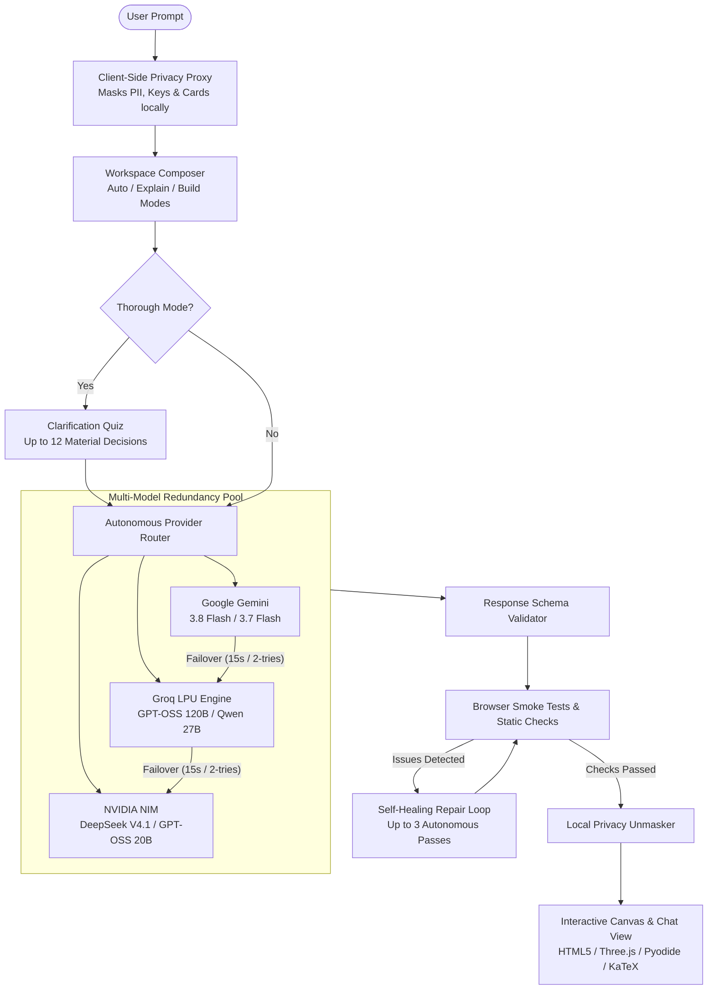

# 🌌 Convoke — The Autonomous Multi-Model AI Workspace

> **Turn ideas into verified explanations, interactive software, and visual simulations — with zero vendor lock-in, zero downtime, and client-side privacy protection.**

[](https://convoke.relatively-simple-team.workers.dev)
[](https://workers.cloudflare.com/)
[](#-autonomous-multi-model-router)
[](#-client-side-privacy-proxy)
[](#-live-interactive-canvas--sandbox)
[](LICENSE)

---

## 🌟 Overview & Elevator Pitch

Most people interact with AI through static chat boxes that suffer from five critical flaws:
1. **Prompt Guesswork:** When a prompt is vague, AI models hallucinate assumptions instead of asking what you actually need.
2. **Single-Model Fragility:** If OpenAI, Google, or Groq suffers an outage or hits a rate-limit, your workflow halts completely.
3. **Dead Text Walls:** Complex systems, mathematics, and algorithms are dumped as static markdown blocks instead of runnable, tangible prototypes.
4. **Single-AI Bias:** Relying on one model leads to blind spots and unverified assertions.
5. **Privacy Leaks:** Proprietary data, API keys, and PII are transmitted in plain text to third-party model providers.

**Convoke is an autonomous multi-model workspace designed to solve these fundamental bottlenecks.** It combines an intelligent edge router with multi-provider redundancy (Google Gemini, Groq, NVIDIA), proactive clarification planning, client-side zero-knowledge privacy masking, parallel AI Boardroom deliberation, and an isolated execution canvas that runs live HTML5/JavaScript, Three.js 3D graphics, KaTeX math, and Python in WebAssembly.

---

## ⚡ The Difference: Chatbots vs. Convoke

| Feature | Standard AI Chatbots | Convoke Workspace |
| :--- | :--- | :--- |
| **Ambiguity Resolution** | Guesses blindly; generates generic or wrong output | **Thorough Mode:** Proactive quiz gathers up to 12 design decisions upfront |
| **Reliability & Redundancy** | Single provider failure = immediate error message | **Autonomous Router:** Cross-provider failover (Gemini, Groq, NVIDIA) with 2-try model switch |
| **Output Medium** | Static text and unverified code snippets | **Live Interactive Canvas:** Runnable HTML/JS, 3D Three.js, KaTeX, and Pyodide Python |
| **Critical Decisions** | Single perspective prone to hallucination | **AI Boardroom:** 3 distinct models draft, cross-examine, and synthesize consensus |
| **Factual Verification** | None; user must manually check answers | **Fact-Check Verifier:** Automated claim extraction, source verification, and 1-click fixes |
| **Privacy Protection** | Prompt sent raw to cloud providers | **Client-Side Privacy Proxy:** Masks keys, cards, and PII locally before sending |
| **Code Reliability** | Broken code requires manual re-prompting | **Self-Healing Engine:** Browser smoke tests and automatic 3-pass runtime repair |
| **Cost Transparency** | Hidden billing or expensive flat subscriptions | **Real-Time Cost Ledger:** Micro-cost accounting ($0.0001 precision) per generation |

---

## 🚀 Key Features

### 🧠 Autonomous Multi-Model Router (Zero Downtime)
Never worry about API outages, rate limits, or regional server spikes again.
- **Smart Task Matching:** Automatically routes tasks to optimal models (e.g. `openai/gpt-oss-120b` for planning and reasoning; `gemini-3.8-flash` for explanations; `qwen/qwen3.8-27b` for high-speed coding).
- **2-Try Model Failover:** If a model times out (15s deadline) or returns an error for 2 tries, Convoke automatically retires it and immediately advances to the next best provider.
- **Sequential Fallback:** Can toggle **Smart Routing** on or off to prefer strict sequential rotation across all connected keys.

### 🎯 Thorough Mode & Clarification Quiz
Great outputs require clear specifications. When a new project starts with **Thorough Mode** enabled:
- Convoke analyzes your prompt for architectural gaps, target audience, technical constraints, workflows, and edge cases.
- Presents an interactive clarification quiz with up to 12 missing decisions, providing multiple-choice recommendations and custom inputs.
- Once answered, Convoke builds the complete solution without repeated interrogation.

### 🎨 Live Interactive Canvas & Sandbox
Convoke doesn't just talk about software—it builds and runs it instantly:
- **Interactive Web Apps & Tools:** Full HTML5, CSS, and modern JavaScript executed in an isolated, secure sandbox.
- **3D Simulations:** Native Three.js integration for physics simulations, geometric models, and interactive visualizations.
- **Client-Side Python (Pyodide):** Runs real Python in a WebAssembly worker right inside the browser. No server compute needed.
- **KaTeX Mathematical Rendering:** Clean rendering of complex formulas, matrices, and LaTeX equations.
- **Mermaid & Data Visualizations:** Dynamic flowcharts, sequence diagrams, and accessible charts with one-click *"Explain in words"*.

### 👥 AI Boardroom Deliberation
For high-stakes decisions, architecture trade-offs, and strategy:
1. **Stage 1 (Parallel Drafting):** Three independent frontier models from different providers draft competing proposals in parallel.
2. **Stage 2 (Anonymous Peer Review):** Proposals are anonymized and distributed for peer critique, scoring strengths, flaws, and risks.
3. **Stage 3 (Chairman Synthesis):** The presiding Chairman analyzes all drafts and debates, issuing a final unified verdict and consensus summary.

### 🔍 Fact-Check Verifier & Second Opinion
- **Fact-Check Verifier:** Extracts objective factual claims from assistant responses, searches authoritative sources, assigns confidence verdicts, and provides one-click replacement patches.
- **Second Opinion:** Dispatches the response to a competing provider (e.g. Gemini audits Groq; NVIDIA audits Gemini) for an independent peer review.

### 🛡️ Client-Side Privacy Proxy
- **Zero-Knowledge Architecture:** Detects and masks API keys, secrets, email addresses, phone numbers, national IDs (SSN / NIC), and credit cards (validated via the Luhn Algorithm) *in the browser* before transmission.
- Cloud providers only see placeholders like `[API_KEY_1]` or `[CARD_NUMBER_1]`.
- When the response returns, Convoke automatically re-hydrates the original data locally on your device.

### 🔧 Self-Healing Code Engine
- Every generated web canvas undergoes automated browser smoke tests and static DOM checks.
- If syntax issues, uncaught exceptions, or styling regressions occur, diagnostics are fed back to an autonomous repair pass (up to 3 attempts) to fix the code automatically before you ever see it.

---

## 🏗️ System Architecture



---

## 🛠️ Tech Stack

- **Edge Runtime:** Cloudflare Workers (Edge V8 Isolates with global sub-10ms distribution)
- **Database:** Cloudflare D1 (Global distributed SQLite with transactions and optimistic locking)
- **Framework & Bundler:** Vite 8 RSC/SSR + Vinext Next.js App Router compatibility layer
- **Frontend:** React 19, TypeScript, Tailwind CSS, Radix UI, Lucide React
- **AI Integrations:** Google Generative AI REST API, Groq OpenAI-compatible API, NVIDIA NIM API
- **In-Browser Sandbox:** Pyodide (Python via WebAssembly), Three.js (WebGL 3D), KaTeX (LaTeX math), Mermaid.js (Diagrams)

---

## 💻 Quickstart & Local Setup

### Prerequisites
- [Node.js](https://nodejs.org/) `>= 22.13.0`
- API keys for at least one provider:
  - [Google AI Studio (Gemini)](https://aistudio.google.com/)
  - [Groq Cloud](https://console.groq.com/)
  - [NVIDIA NIM](https://build.nvidia.com/) *(optional)*

### 1. Clone the Repository
```bash
git clone https://github.com/YOUR_USERNAME/convoke.git
cd convoke
```

### 2. Install Dependencies
```bash
npm ci
```

### 3. Configure Local Secrets
Create a `.dev.vars` file in the project root:
```env
GEMINI_API_KEY=your_gemini_api_key_here
GROQ_API_KEY=your_groq_api_key_here
NVIDIA_API_KEY=your_nvidia_api_key_here
```

### 4. Run the Development Server
```bash
npm run dev
```
Open [http://localhost:3000](http://localhost:3000) in your browser.

---

## 🧪 Testing & Verification

Convoke comes with an end-to-end automated test suite covering all routers, security proxies, database contracts, and browser rendering:

```bash
# Run all 14 unit and integration test suites
npm test

# Run TypeScript type safety verification
npm run typecheck

# Run production build validation
npm run build:selfhost
```

---

## 🌐 Deploying to Cloudflare Workers

Convoke can be deployed to your own Cloudflare account in under 3 minutes:

```bash
# 1. Login to Cloudflare Wrangler
npx wrangler login

# 2. Build the self-host worker
npm run build:selfhost

# 3. Add your production API secrets
npx wrangler secret put GEMINI_API_KEY
npx wrangler secret put GROQ_API_KEY
npx wrangler secret put NVIDIA_API_KEY

# 4. Deploy live to the edge
npm run deploy:selfhost
```

Your app will be live at `https://convoke.<your-subdomain>.workers.dev` with a globally replicated D1 SQLite database and edge worker.

---

## 🔒 Security & Privacy Architecture

- **No Server Execution of Code:** Generated JavaScript and Python code are never executed on the application server. All execution happens in an opaque-origin, network-restricted iframe or client-side WebAssembly worker.
- **Client-Side Masking:** Sensitive credentials and PII are stripped *before* outgoing network calls, ensuring third-party LLMs never ingest private user data.
- **Secrets Management:** Cloudflare Workers secrets are stored securely in Cloudflare's KMS and never exposed to the client bundle.
- **Optimistic Concurrency:** Cloudflare D1 atomic version locks prevent race conditions and overwrite collisions during simultaneous generations.

---

## 📄 License

This project is licensed under the [MIT License](LICENSE).

---

<p align="center">
  Built with ❤️ by the Convoke Team · <a href="https://convoke.relatively-simple-team.workers.dev">Try the Live Demo</a>
</p>
